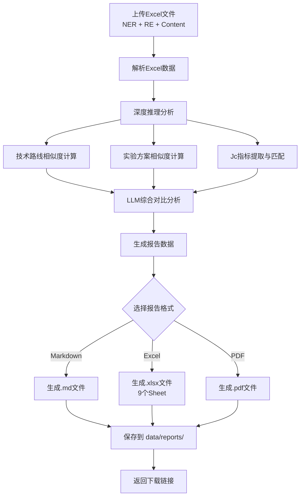

# NER+RE+Content Excel 报告生成说明

## 📋 概述

本文档详细说明当系统接收到包含 **NER（命名实体识别）+ RE（关系抽取）+ Content（原文内容）** 三个工作表的Excel文件后，会进行深度推理分析并生成的报告格式、结构和代码位置。

---

## 🎯 输入数据格式

### Excel文件结构要求

输入的Excel文件必须包含以下3个Sheet：

#### Sheet 1: `content` - 原文内容
| 字段 | 说明 | 示例 |
|------|------|------|
| doi | 论文DOI标识符 | 10.1088/1361-6668/xxx |
| section_idx | 段落序号 | 1, 2, 3... |
| group_idx | 分组索引 | 通常为1 |
| heading | 章节标题 | abstract, Introduction, Methods... |
| text | 文本内容 | 该段落的完整文本 |

#### Sheet 2: `NER` - 命名实体识别结果
| 字段 | 说明 | 示例 |
|------|------|------|
| doi | 论文DOI | 10.1088/1361-6668/xxx |
| entity | 实体文本 | YBa2Cu3O7 |
| type | 实体类型 | Material, Method... |
| subtype | 子类型 | Superconductor |
| section | 所在章节 | Introduction |
| part | 段落编号 | 1, 2, 3... |

#### Sheet 3: `RE` - 关系抽取结果
| 字段 | 说明 | 示例 |
|------|------|------|
| head_entity | 头实体 | PLD |
| tail_entity | 尾实体 | YBa2Cu3O7 |
| relation_type | 关系类型 | used_to_fabricate |
| confidence | 置信度 | 0.95 |
| doi | 论文DOI | 10.1088/1361-6668/xxx |

---

## 📊 生成的报告类型

系统支持生成 **3种格式** 的报告：

1. **Markdown (.md)** - 适合阅读和版本控制
2. **Excel (.xlsx)** - 多工作表结构化数据，便于数据分析
3. **PDF (.pdf)** - 便携式文档，适合打印和分享

---

## 📑 Excel报告详细格式（9个Sheet）

**代码位置**: [`backend/services/report_service.py`](file:///E:/武汉工作/00.%20研究课题/Article_Analysis_System_v2/backend/services/report_service.py#L395-L560)

### Sheet 1: 摘要 (Summary)

提供整个分析报告的概览信息。

| 字段 | 说明 | 示例值 |
|------|------|--------|
| 任务 ID | 分析任务的唯一标识 | task_abc123 |
| 生成时间 | 报告生成时间戳 | 2024-04-24 10:30:00 |
| 目标 DOI | 被分析的论文DOI | 10.1088/1361-6668/xxx |
| 技术路线相似论文数 | 找到的相似技术路线数量 | 15 |
| 最高技术路线相似度 | 最相似论文的相似度 | 95.5% |
| 实验方案相似论文数 | 找到的相似实验方案数量 | 12 |
| 最高实验方案相似度 | 最相似实验方案的相似度 | 90.2% |
| 提取 Jc 指标数 | 从Content中提取的Jc指标数量 | 8 |
| Jc 匹配论文数 | 数据库中找到匹配的论文数 | 25 |
| Content 总段落数 | 用于分析的段落总数 | 45 |
| 匹配的 Content 段落数 | 包含Jc信息的段落数 | 12 |
| Jc 提取耗时 (秒) | Jc提取过程耗时 | 3.25 |

---

### Sheet 2: 技术路线比较 (Techroute Comparison)

展示与目标论文技术路线相似的论文列表。

| 字段 | 类型 | 说明 |
|------|------|------|
| doi | string | 相似论文的DOI |
| similarity_score | float | 技术路线相似度分数 (0-1) |
| title | string | 论文标题 |
| route_text | string | 技术路线描述文本 |

**示例数据**:
```
doi: 10.1016/j.physc.2020.xxx
similarity_score: 0.955
title: High-performance YBCO coated conductors...
route_text: 采用PLD技术在IBAD-MgO缓冲层上沉积YBCO薄膜...
```

---

### Sheet 3: 实验方案比较 (Expscheme Comparison)

展示与目标论文实验方案相似的论文列表。

| 字段 | 类型 | 说明 |
|------|------|------|
| doi | string | 相似论文的DOI |
| similarity_score | float | 实验方案相似度分数 (0-1) |
| title | string | 论文标题 |
| exp_scheme_categories | list | 实验方案类别列表 |
| exp_scheme_text | string | 实验方案详细描述 |

**实验方案类别包括**:
- 材料准备 (Material Preparation)
- 沉积技术 (Deposition Techniques)
- 工艺参数 (Process Parameters)
- 后处理 (Post-processing)
- 表征技术 (Characterization Techniques)
- 系统约束 (System Constraints)
- 模拟分析 (Simulation)
- 辐照处理 (Irradiation)

---

### Sheet 4: Jc 指标比较 (Jc Index Comparison)

按实验条件分组的Jc临界电流密度排名对比。

| 字段 | 类型 | 说明 |
|------|------|------|
| 条件_温度 | float/int | 测试温度 (K) |
| 条件_磁场 | float/int | 外加磁场 (T) |
| 条件_角度 | float/int | 磁场角度 (°) |
| 排名 | int | 在该条件下的排名 |
| DOI | string | 论文DOI |
| Jc最大值 | float | 最大临界电流密度 (A/cm²) |
| 是否目标 | string | "是" 或 "否" |
| 总论文数 | int | 该条件下匹配的论文总数 |
| 目标排名 | int | 目标论文的排名 |
| 目标Jc最大 | float | 目标论文的最大Jc值 |
| 最佳Jc最大 | float | 所有论文中的最佳Jc值 |

**示例**:
```
条件_温度: 77
条件_磁场: 1.0
条件_角度: 0
排名: 3
DOI: 10.1088/1361-6668/xxx
Jc最大值: 1.23e+06
是否目标: 是
总论文数: 10
目标排名: 3
目标Jc最大: 1.23e+06
最佳Jc最大: 1.50e+06
```

---

### Sheet 5: 综合结果 (Combined Results)

综合技术路线和实验方案相似度的排名结果。

| 字段 | 类型 | 说明 |
|------|------|------|
| doi | string | 论文DOI |
| combined_score | float | 综合得分 (0-1) |
| techroute_score | float | 技术路线得分 (0-1) |
| expscheme_score | float | 实验方案得分 (0-1) |
| title | string | 论文标题 |

---

### Sheet 6: NER 实体 (NER Entities)

直接从输入Excel的NER sheet复制过来的原始数据。

包含所有命名实体识别结果，字段与输入一致。

---

### Sheet 7: RE 关系 (RE Relations)

直接从输入Excel的RE sheet复制过来的原始数据。

包含所有关系抽取结果，字段与输入一致。

---

### Sheet 8: Jc 提取源段落 (Jc Extraction Segments)

记录用于提取Jc指标的原始Content段落。

| 字段 | 类型 | 说明 |
|------|------|------|
| 段落序号 | int | 段落编号 (从1开始) |
| Content 段落 | string | 包含Jc信息的原文段落 |

**用途**: 追溯Jc提取的来源，验证提取准确性。

---

### Sheet 9: Jc 提取结果 (Jc Extracted Indices)

从Content中提取的所有Jc指标详细信息。

| 字段 | 类型 | 说明 |
|------|------|------|
| DOI | string | 论文DOI |
| Jc | string/float | 临界电流密度值 |
| Jc_unit | string | Jc单位 (如 A/cm²) |
| temperature | string/float | 测试温度 (K) |
| magnetic_field | string/float | 外加磁场 (T) |
| angle | string/float | 磁场角度 (°) |
| error_bar | string | 误差范围 (如有) |

**示例**:
```
DOI: 10.1088/1361-6668/xxx
Jc: 1.23e+06
Jc_unit: A/cm²
temperature: 77
magnetic_field: 1.0
angle: 0
error_bar: ±0.05e+06
```

---

## 📝 Markdown报告详细格式

**代码位置**: [`backend/services/report_service.py`](file:///E:/武汉工作/00.%20研究课题/Article_Analysis_System_v2/backend/services/report_service.py#L31-L393)

### 报告结构

```markdown
# 📊 SciPDF AI 论文分析报告

**任务 ID**: `task_xxx`  
**生成时间**: 2024-04-24 10:30:00  
**目标 DOI**: `10.1088/1361-6668/xxx`  

---

## 一、摘要

- **任务 ID**: task_xxx
- **生成时间**: 2024-04-24 10:30:00
- **目标 DOI**: 10.1088/1361-6668/xxx
- **技术路线相似论文数**: 15
- **最高技术路线相似度**: 95.5%
- **实验方案相似论文数**: 12
- **最高实验方案相似度**: 90.2%
- **提取 Jc 指标数**: 8
- **Jc 匹配论文数**: 25
- **Content 总段落数**: 45
- **匹配的 Content 段落数**: 12
- **Jc 提取耗时 (秒)**: 3.25

**综合结论**: [LLM生成的综合分析结论]

---

## 二、技术路线分析

| 排名 | DOI | 相似度 | 标题 |
|------|-----|--------|------|
| 1 | 10.1016/j.physc.2020.xxx | 95.5% | High-performance YBCO... |
| 2 | 10.1109/TASC.2019.xxx | 92.3% | Advanced fabrication... |
| ... | ... | ... | ... |

### 2.1 技术路线详情对比

#### 目标论文技术路线

采用PLD技术在IBAD-MgO缓冲层上沉积YBCO薄膜，优化氧含量和微观结构...

#### 相似论文技术路线

**1. 10.1016/j.physc.2020.xxx (相似度: 95.5%)**:
> 使用类似的PLD工艺，在CeO2缓冲层上生长YBCO涂层导体...

**2. 10.1109/TASC.2019.xxx (相似度: 92.3%)**:
> 采用MOCVD方法制备YBCO薄膜，实现高Jc性能...

---

## 三、实验方案分析

### 3.1 实验方案相似度排名

| 排名 | DOI | 相似度 | 标题 | 实验方案类别 |
|------|-----|--------|------|--------------|
| 1 | 10.1016/j.physc.2020.xxx | 90.2% | xxx | 材料准备, 沉积技术 |
| 2 | 10.1109/TASC.2019.xxx | 87.5% | xxx | 工艺参数, 后处理 |
| ... | ... | ... | ... | ... |

### 3.2 实验方案类别对比

**目标论文实验方案类别**: 材料准备, 沉积技术, 工艺参数, 后处理, 表征技术

**类别覆盖统计**:

| 类别 | 目标论文 | 相似论文数 |
|------|----------|------------|
| 材料准备 | ✓ | 5 (doi1, doi2...) |
| 沉积技术 | ✓ | 3 (doi3, doi4...) |
| 工艺参数 | ✓ | 4 (...) |
| 后处理 | ✓ | 2 (...) |
| 表征技术 | ✓ | 6 (...) |
| 系统约束 | - | 1 (...) |
| 模拟分析 | - | 0 |
| 辐照处理 | - | 0 |

### 3.3 实验方案详情对比

#### 目标论文实验方案

• "材料准备"
  • 使用高纯度Y2O3, BaCO3, CuO粉末作为原料
  • 按摩尔比1:2:3混合
  
• "沉积技术"
  • 采用脉冲激光沉积(PLD)技术
  • 激光能量密度: 2 J/cm²
  • 基底温度: 780°C

• "工艺参数"
  • 氧压: 200 mTorr
  • 沉积速率: 0.1 Å/pulse

#### 相似论文实验方案

**1. 10.1016/j.physc.2020.xxx (相似度: 90.2%) 类别: 材料准备, 沉积技术**
> • "材料准备"
>   • 使用化学溶液沉积(CSD)前驱体
> • "沉积技术"
>   • 采用金属有机化学气相沉积(MOCVD)...

---

## 四、综合对比分析

### 4.1 技术路线对比

**共同特征**:
- 都采用物理气相沉积技术
- 都需要缓冲层来提高外延质量
- 都关注界面工程优化

**关键差异**:
- 目标论文使用PLD，而部分相似论文使用MOCVD
- 缓冲层材料选择不同（IBAD-MgO vs CeO2）
- 退火工艺参数存在差异

**详细分析**:
[LLM生成的详细技术分析文本...]

### 4.2 实验方案对比（8个维度）

#### 材料准备

**共同特征**:
- 都使用高纯度原料
- 都注重化学计量比控制

**关键差异**:
- 目标论文使用固相反应法
- 相似论文1使用溶胶-凝胶法

**详细分析**: 目标论文的材料制备方法更简单，但相似论文1的方法能更好地控制成分均匀性...

#### 沉积技术

**共同特征**:
- 都采用真空沉积技术
- 都需要精确的温度控制

**关键差异**:
- PLD vs MOCVD vs CSD
- 沉积速率差异较大

**详细分析**: ...

(其他6个维度：工艺参数、后处理、表征技术、系统约束、模拟分析、辐照处理)

### 4.3 分析总结

**最相似论文**:
- `10.1016/j.physc.2020.xxx`
- `10.1109/TASC.2019.xxx`

**关键发现**:
- 目标论文在77K自场下的Jc性能处于中上水平
- 采用的PLD工艺成熟度高，但沉积速率较慢
- 缓冲层设计合理，但与最新研究相比有改进空间

**技术趋势**:
当前超导涂层导体领域正朝着更高沉积速率、更低成本的方向发展，MOCVD和CSD技术受到更多关注...

---

## 五、Jc 指标分析

### 5.1 按实验条件分组的 Jc 排名

**条件组**: 温度=77K, 磁场=1.0T, 角度=0°

- 匹配记录数: 15
- 目标排名: 3/10 (前 30%)
- 目标 Jc 最大值: 1.23e+06 A/cm²
- 最佳 Jc 最大值: 1.50e+06 A/cm²

| 排名 | DOI | Jc 最大值 (A/cm²) |
|------|-----|-------------------|
| 1 | 10.1016/j.physc.2021.xxx | 1.50e+06 |
| 2 | 10.1109/TASC.2020.xxx | 1.35e+06 |
| 3 | 10.1088/1361-6668/xxx | 1.23e+06 ← 目标 |
| 4 | 10.1063/1.xxx | 1.18e+06 |
| ... | ... | ... |

**条件组**: 温度=77K, 磁场=3.0T, 角度=0°

- 匹配记录数: 8
- 目标排名: 2/8 (前 25%)
- 目标 Jc 最大值: 5.67e+05 A/cm²
- 最佳 Jc 最大值: 6.20e+05 A/cm²

| 排名 | DOI | Jc 最大值 (A/cm²) |
|------|-----|-------------------|
| 1 | 10.1016/j.physc.2021.xxx | 6.20e+05 |
| 2 | 10.1088/1361-6668/xxx | 5.67e+05 ← 目标 |
| ... | ... | ... |

### 5.2 Jc 提取详情

| 项目 | 数值 |
|------|------|
| 目标 DOI | 10.1088/1361-6668/xxx |
| Content 总段落数 | 45 |
| 匹配段落数 | 12 |
| 提取 Jc 数量 | 8 |
| 提取耗时 (秒) | 3.25 |

### 5.3 使用的 Content 段落

**段落 1**:
> The critical current density (Jc) of the YBCO coated conductor was measured to be 1.2 × 10^6 A/cm² at 77 K in self-field...

**段落 2**:
> Under an applied magnetic field of 1 T parallel to the c-axis, the Jc decreased to 5.6 × 10^5 A/cm² at 77 K...

### 5.4 提取的 Jc 指标

| 序号 | Jc 值 | 单位 | 温度 | 磁场 | 角度 |
|------|------|------|------|------|------|
| 1 | 1.20e+06 | A/cm² | 77 | 0 | 0 |
| 2 | 5.60e+05 | A/cm² | 77 | 1.0 | 0 |
| 3 | 3.20e+05 | A/cm² | 77 | 3.0 | 0 |
| 4 | 1.80e+05 | A/cm² | 77 | 5.0 | 0 |
| 5 | 8.50e+05 | A/cm² | 65 | 0 | 0 |
| ... | ... | ... | ... | ... | ... |

---

## 六、综合结论

[此处为LLM生成的综合分析结论，包括：]
- 目标论文的技术优势和不足
- 与现有研究的对比分析
- 未来改进建议
- 技术发展趋势预测

例如：
目标论文采用成熟的PLD工艺制备YBCO涂层导体，在77K自场下实现了1.2 MA/cm²的Jc性能，处于同类研究中上水平。技术路线方面，与95.5%相似度的论文采用了类似的缓冲层设计，但在沉积速率上有待提升。实验方案上，目标论文覆盖了材料准备、沉积技术、工艺参数等5个核心类别，与领域内主流方案一致。Jc指标分析显示，在77K/1T条件下，目标论文排名第3/10，表现良好但在高场性能上与最优研究仍有差距。建议后续研究可考虑优化沉积速率、探索新型缓冲层材料，以及加强高场性能的改善。
```

---

## 🔧 核心代码位置

### 1. 报告服务主类

**文件**: [`backend/services/report_service.py`](file:///E:/武汉工作/00.%20研究课题/Article_Analysis_System_v2/backend/services/report_service.py)

**主要方法**:

| 方法名 | 行号 | 功能 |
|--------|------|------|
| `generate_excel_report()` | 395-560 | 生成Excel格式报告（9个Sheet） |
| `generate_markdown_report()` | 31-54 | 生成Markdown格式报告 |
| `_generate_markdown_content()` | 56-393 | 生成Markdown内容 |
| `generate_pdf_report()` | 561-777 | 生成PDF格式报告 |
| `_create_summary_sheet()` | 779-818 | 创建摘要数据 |

### 2. 批量Excel生成（原始数据合并）

**文件**: [`backend/services/batch_service.py`](file:///E:/武汉工作/00.%20研究课题/Article_Analysis_System_v2/backend/services/batch_service.py#L388-L502)

**方法**: `generate_batch_excel()` - 生成包含content/NER/RE三个sheet的基础Excel

### 3. API接口

**文件**: [`backend/api/deep_reasoning.py`](file:///E:/武汉工作/00.%20研究课题/Article_Analysis_System_v2/backend/api/deep_reasoning.py#L603)

调用报告生成服务的API端点。

### 4. 前端页面

**文件**: [`backend/templates/full_analysis.html`](file:///E:/武汉工作/00.%20研究课题/Article_Analysis_System_v2/backend/templates/full_analysis.html#L130-L146)

完整分析报告展示页面，包含导出按钮。

---

## 🔄 完整处理流程



---

## 📁 输出文件位置

生成的报告文件保存在：

```
data/reports/
├── {task_id}_report.md      # Markdown格式
├── {task_id}_report.xlsx    # Excel格式（9个Sheet）
└── {task_id}_report.pdf     # PDF格式
```

其中 `{task_id}` 是分析任务的唯一标识符。

---

## 💡 使用建议

### 1. 选择合适的报告格式

- **Markdown**: 适合版本控制、在线查看、快速浏览
- **Excel**: 适合数据分析、筛选排序、二次处理
- **PDF**: 适合打印、正式汇报、存档

### 2. 重点关注的内容

1. **Sheet 4 (Jc指标比较)**: 了解目标论文在不同实验条件下的性能排名
2. **Sheet 5 (综合结果)**: 快速找到最相似的参考文献
3. **第四章 (综合对比分析)**: LLM生成的深度洞察和技术趋势
4. **Sheet 8 & 9 (Jc提取详情)**: 验证Jc提取的准确性和完整性

### 3. 数据追溯

- 通过 **Sheet 8 (Jc提取源段落)** 可以追溯到原始Content
- 通过 **Sheet 6 & 7 (NER/RE)** 可以查看完整的实体和关系信息
- 所有数据都与原始输入保持一致，便于验证

---

## ❓ 常见问题

### Q1: 为什么有些Sheet是空的？

**A**: 如果某个分析模块没有数据（如没有找到相似的技术路线），对应的Sheet会显示"暂无数据"提示。

### Q2: Jc指标为什么有时无法分组排名？

**A**: 需要至少2个不同的温度/磁场/角度条件才能进行分组排名。如果提取的条件不足，只会显示提取的Jc指标汇总。

### Q3: 如何自定义报告内容？

**A**: 修改 `backend/services/report_service.py` 中的相应方法，调整要包含的数据字段和格式。

### Q4: 报告生成失败怎么办？

**A**: 检查日志文件 `logs/app.log`，常见原因包括：
- 输入Excel格式不正确
- 缺少必要的列
- 数据中存在特殊字符
- reportlab未安装（PDF生成需要）

---

## 📚 相关文档

- [架构设计文档](./架构设计文档.md)
- [项目需求分析](./项目需求分析.md)
- [Deep Reasoning Analysis](./DEEP_REASONING_ANALYSIS.md)

---

**文档版本**: v1.0  
**最后更新**: 2024-04-24  
**维护者**: Article Analysis System Team
